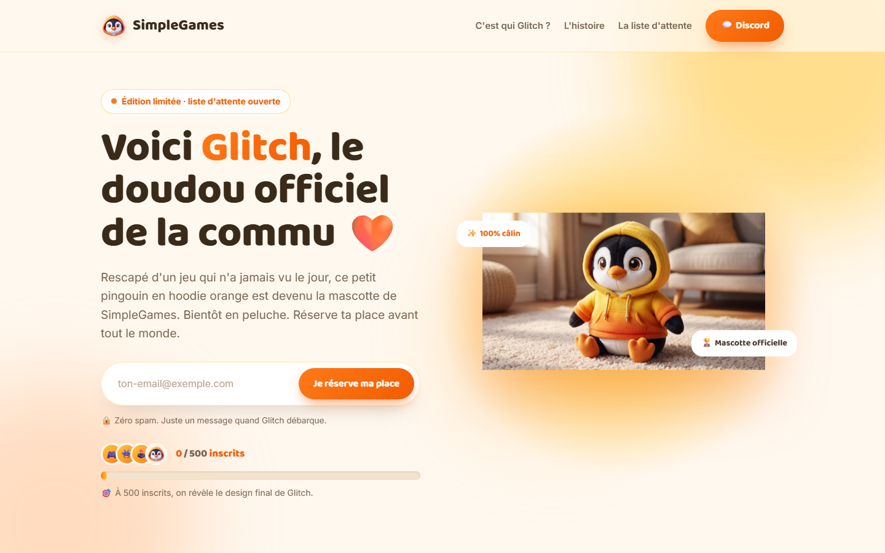
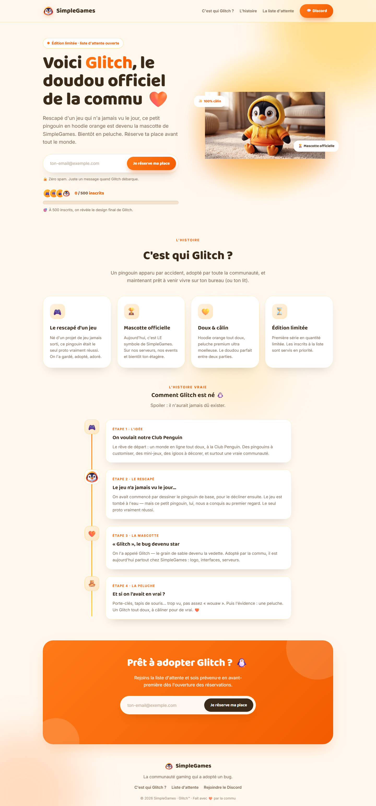

<div align="center">


<br/>

# 🐧 Glitch Shop

**La page de lancement de Glitch, la future peluche mascotte de la communauté SimpleGames.**
Une landing page qui fait monter la hype, avec liste d'attente et compteur d'inscrits en direct.

[](https://simple-games-net.web.app)


</div>

---

## 📸 Aperçu

<div align="center">

<br/><br/>

</div>

<details>
<summary><b>🖼️ Voir la page complète</b></summary>
<br/>

</details>

## ✨ Ce que fait la page

- 🎯 **Hero** avec la mascotte, badge « édition limitée » et formulaire de réservation.
- 📈 **Compteur en direct** « X / 500 inscrits » avec jauge de progression (objectif : dévoiler le design final à 500).
- 📖 **L'histoire de Glitch** : une frise en 4 étapes, du jeu jamais sorti à la peluche.
- 💌 **Liste d'attente** : les emails sont enregistrés dans Firestore, sans jamais être lisibles côté client.
- 🔗 **Partage** : lien de partage et raccourci vers le Discord de la communauté.
- 📱 **Responsive** : pensée d'abord pour le mobile, avec balises Open Graph pour le partage sur les réseaux.

## 🧱 Stack

| Brique | Utilisation |
|---|---|
| **Firebase Hosting** | Sert la page statique (`public/`), avec des en-têtes de cache optimisés |
| **Cloud Firestore** | Collection `waitlist` + document `public/stats` (compteur) |
| **HTML / CSS / JS** | Aucun framework, aucune étape de build : des modules ES chargés directement |

## 🔒 Sécurité & vie privée

Les règles [`firestore.rules`](firestore.rules) garantissent que :

- 📨 **`waitlist/{id}`** accepte **uniquement la création**, avec un email au format valide (moins de 254 caractères). Personne ne peut **lire, modifier ni supprimer** la liste depuis le site.
- 🔢 **`public/stats`** peut être **lu par tous**, mais ne peut être **incrémenté que de +1** à la fois (anti-triche de base).

> 💡 Pour un compteur vraiment infalsifiable, il faudrait déplacer l'incrément dans une **Cloud Function** déclenchée à chaque nouveau document `waitlist`.

## 🗂️ Structure

```
Glitch-Shop/
├─ public/
│  ├─ index.html        # la landing
│  ├─ styles.css        # thème orange / jaune façon Glitch
│  ├─ app.js            # liste d'attente + compteur (Firebase)
│  ├─ robots.txt · sitemap.xml
│  └─ assets/           # mascotte, favicon, image Open Graph
├─ firebase.json        # config Hosting (cleanUrls, cache)
├─ firestore.rules      # règles de sécurité
└─ .firebaserc          # projet Firebase
```

## 🚀 Lancer en local

```bash
npx serve public
```

Puis ouvre l'adresse affichée. Le formulaire et le compteur fonctionnent dès que la config Firebase de `public/app.js` pointe vers un projet où Firestore est activé.

## ☁️ Déployer

```bash
firebase login                                   # une seule fois
firebase deploy --only firestore:rules,hosting
```

Pour utiliser ton propre projet, remplace l'ID dans `.firebaserc` et l'objet `firebaseConfig` dans `public/app.js`.

**Domaine personnalisé** : dans la console Firebase, **Hosting → Ajouter un domaine personnalisé**, puis ajoute les enregistrements DNS (A / TXT) chez ton registrar.

## 📬 Récupérer les inscrits

Console Firebase → **Firestore → collection `waitlist`**. Tu peux exporter en CSV via la console ou avec un petit script Admin SDK.

## 🛣️ Feuille de route

- [ ] Remplacer le visuel prototype par le **rendu final** de la peluche
- [ ] Brancher la vente : **Shopify Buy Button** (simple) ou boutique Shopify complète (pro)
- [ ] Déplacer l'incrément du compteur dans une **Cloud Function**

---

<div align="center">
<sub>🐧 Fait avec 🧡 pour la commu <b>SimpleGames</b> par <a href="https://github.com/ThomasGJack">ThomasGJack</a></sub>
</div>
